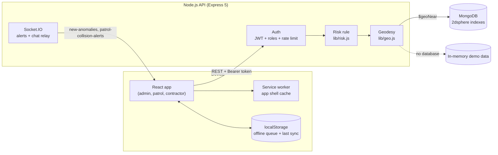

# LineVigil architecture and design decisions

This document explains how LineVigil works and why it is built this way: the problem it solves, the decisions behind the backend, what each one costs, and what I would change next.

## The problem

Third-party digging is one of the most common causes of damage to buried oil and gas pipelines. The protection process has three parties who rarely share one view:

- **Contractors** who want to dig, and need to know whether a site is close to a pipeline.
- **Admins** at the pipeline operator, who decide which permits need a site visit and who goes.
- **Patrol officers**, who check sites in person, often on rural stretches with weak or no mobile signal.

LineVigil gives all three one shared map and one rule for how dangerous a site is.

## System overview

| Path | Responsibility |
| --- | --- |
| `backend/app.js` | Builds the Express app: security headers, CORS, JSON limits, health check, routes, JSON errors. No network side effects, so tests import it directly |
| `backend/index.js` | Starts the HTTP and Socket.IO server, or exports the app for Vercel |
| `backend/lib/geo.js` | Haversine distance, point-to-segment and point-to-polyline distance, coordinate validation |
| `backend/lib/risk.js` | The one risk rule: thresholds and `classifyRisk` |
| `backend/lib/config.js` | Environment handling, including refusing to run in production without `JWT_SECRET` |
| `backend/lib/http.js` | Typed HTTP errors and the error handler |
| `backend/lib/rateLimit.js` | Fixed-window rate limiter for sign-in and sign-up |
| `backend/lib/sampleData.js` | Demo pipelines, permits and detections, scored with the real rule |
| `backend/db.js` | Data access for MongoDB, with the in-memory fallback behind the same functions |
| `backend/routes/` | One router per area: auth, excavations, patrol, imagery, pipelines, cgd |

## Decisions

### 1. One risk rule, in one place

**Before:** creating a permit used 500 m / 1 km, but the live check that contractors saw while picking a site used 100 m / 500 m. A site 300 m from a pipeline showed as medium risk while choosing it and was then filed as high risk. The frontend also had its own copy of a third version for when the API was down.

**Now:** `lib/risk.js` defines the thresholds once (under 500 m high, 500 m to 1 km medium, otherwise low). Permits, the live check, simulated detections and patrol proximity alerts all call `classifyRisk`. `/api/health` and the check-collision response publish the thresholds, so the client never has to hard-code them. The frontend no longer guesses a risk level when the API is unreachable; it says the check could not run.

**Why:** for a safety check, the dangerous failure is showing "safe" when it is not. Two rules that disagree guarantee that this happens somewhere.

### 2. Distances in metres, measured properly

**Before:** distance to a pipeline was computed in degrees and multiplied by 111,320 m. Away from the equator a degree of longitude is shorter than a degree of latitude (about 12% shorter at 28.5° N, around Delhi). East-west distances therefore came out about 14% too long, and some high-risk sites were classified as medium.

**Now:** `distanceToSegment` projects the segment onto a local plane centred on the site, scaling longitude by cos(latitude), finds the closest point there, and then measures the true distance with haversine. With MongoDB, the nearest pipeline comes from a `$geoNear` query on a `2dsphere` index, which is spherical as well.

**Trade-off:** this is an approximation of a full ellipsoidal (Vincenty) solution. At the distances that matter here (well under a few kilometres) the difference is a few metres. That is far smaller than the 500 m bands, and the code stays short enough to test and explain. The tests check known distances, such as New Delhi to Mumbai (about 1,150 km) and a point 1 km east of a north-south line at 28.5° N, and they pin down how far off the old shortcut was.

### 3. Offline sync that is safe to retry

**Problem:** patrol officers lose signal. The app queues GPS points in `localStorage` and uploads them when the connection returns. A connection that drops halfway through an upload makes the client retry, and before this change every retry stored the same points again.

**Now:** each point gets a `client_id` (a UUID) on the device when it is recorded. The server stores a point only if it has no point with that `client_id` for that officer yet. MongoDB enforces this with a unique partial index on `{ patrol_id, client_id }`, and the in-memory store checks it the same way. The sync response reports `synced`, `duplicates` and `rejected`, so the client knows exactly what landed. Bad points are rejected one by one and do not fail the whole batch. Batches are capped at 500 points.

**Trade-off:** points recorded by older clients without a `client_id` cannot be deduplicated. They are still accepted, so nothing is lost.

The app shell itself is cached by a service worker. API calls always go to the network, page loads use the network first and fall back to the cache, and hashed build assets are served from the cache. The patrol dashboard therefore opens with no signal and shows the tasks from its last successful sync.

### 4. Roles are enforced on the server

**Before:** sign-up accepted a `role` field, so anyone could create an admin account. Any signed-in user could list every permit or mark any permit as verified.

**Now:**

- Sign-up always creates a contractor. Admin and patrol accounts are not self-service.
- `requireRole(...)` guards each route. Missing or expired tokens get **401**, and signed-in users without the right role get **403**, so the client can tell "sign in again" apart from "not allowed".
- A patrol officer can verify or check in only on permits assigned to them.
- Assigning a permit checks that the target account really is a patrol officer.
- Sign-in and sign-up are rate-limited (10 per minute per IP), and wrong-email and wrong-password failures return the same message, so the endpoint does not reveal which emails have accounts.
- In production there is no fallback secret. If `JWT_SECRET` is missing, sign-in fails with a server error instead of issuing tokens anyone could forge.

### 5. A demo that always runs, and is honest about it

The live demo has to work without a database. `db.js` exposes the same functions in both modes. If MongoDB is unreachable, or `LINEVIGIL_DB=memory` is set, it serves the in-memory dataset. A `ready` promise makes every request wait until the mode is decided, so no request runs against a half-initialised data layer.

The demo data goes through the same rule as live data: `lib/sampleData.js` computes each sample permit's distance and risk from the geometry, and a test confirms that each seeded permit matches a live check at the same spot.

There is no satellite imagery provider. The "satellite sweep" is labelled as a simulation everywhere: the API stores `source: "simulated-satellite"` and `simulated: true`, and the admin UI says "Run simulated sweep". The simulated detection is placed near a real pipeline route, and its risk comes from its measured distance, not a random choice.

### 6. Serverless hosting and live updates

The project deploys on Vercel as two services: the static frontend and the Express API as a function. Serverless functions do not keep long-lived connections, so Socket.IO events (new detections, proximity alerts, chat relay) only work when the API runs as a normal server: locally, in Docker, or on a host such as Render or Cloud Run. REST works the same in both setups. The app treats live events as an extra, not a requirement: after every action it reloads the data it needs over REST.

## Testing

`npm test` in `backend/` runs the Node built-in test runner with no extra dependencies:

- **Unit tests** for geodesy (known distances, segment ends, longitude scaling, coordinate validation), the risk rule (exact thresholds, invalid input) and the rate limiter.
- **API tests** start the real Express app on a random port against the in-memory dataset and cover sign-in, sign-up role forcing, 401 versus 403, permit validation, agreement between the live check and filing, patrol assignment rules, idempotent sync, simulated sweep labels, JSON errors, and the demo data agreeing with the risk rule.

GitHub Actions runs the backend tests and the frontend production build on every push to `main` and on every pull request.

## What I would do next

1. **Store chat and incident photos.** Chat is relayed live and lost on reload, and photos are URLs. Messages should go in a collection and photos in object storage with signed upload URLs.
2. **Run Socket.IO on a long-running host,** or replace it with server-sent events, so live alerts work in the deployed demo.
3. **Background Sync.** The service worker could replay the offline queue itself through the Background Sync API, so points upload even if the officer closes the tab.
4. **Real imagery.** Swap the simulated sweep for change detection on Sentinel-2 tiles over the right-of-way buffer. The rest of the pipeline (scoring, storage and alerts) already works on real coordinates.
5. **Audit trail.** Record who changed each permit's status and when, as an append-only log rather than fields on the permit.
6. **Code-split the frontend.** Each portal could load as its own chunk, since the bundle is above 500 kB.
