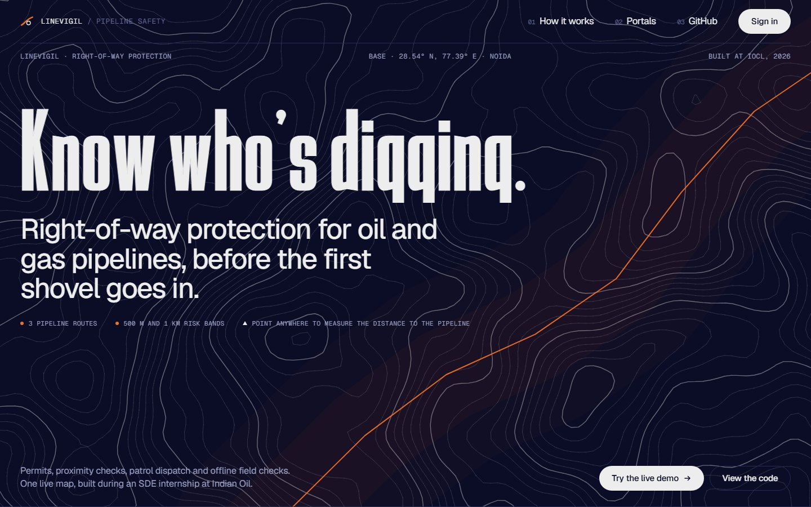
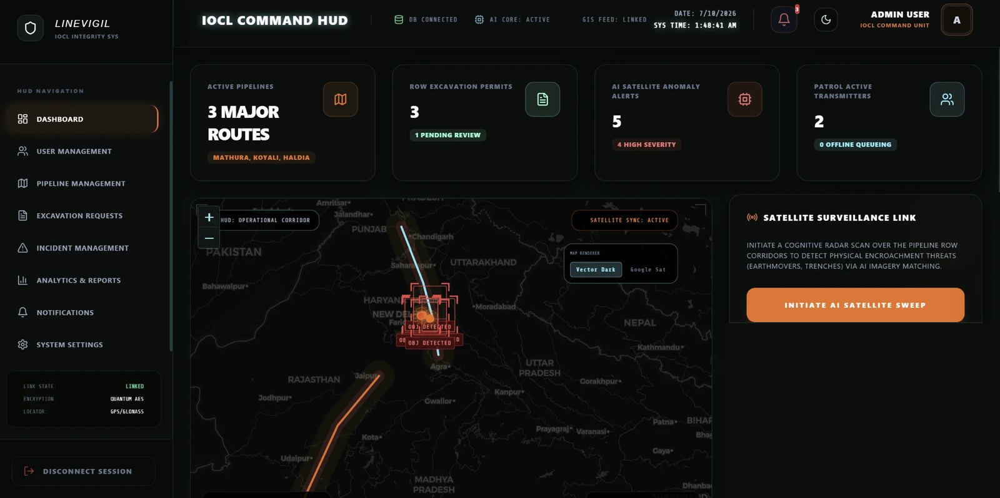
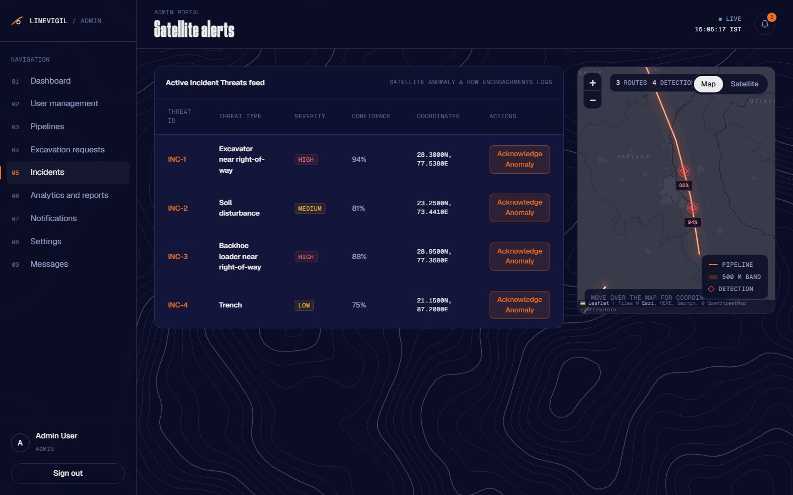
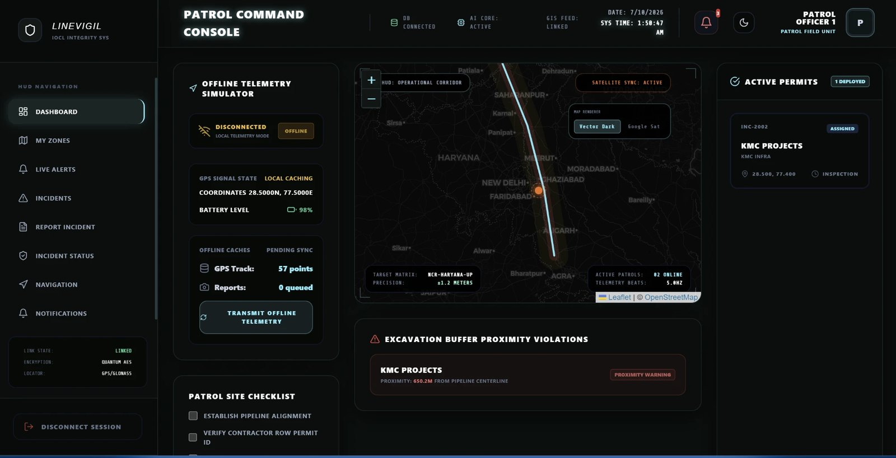
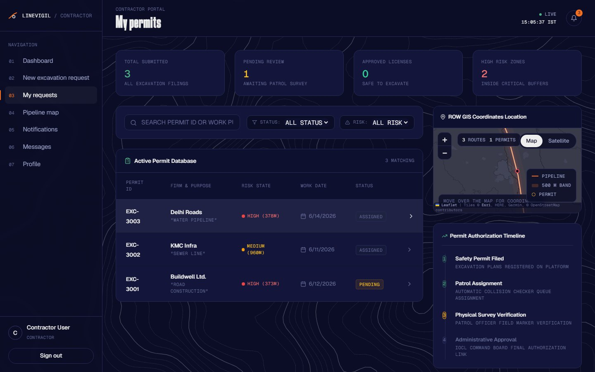
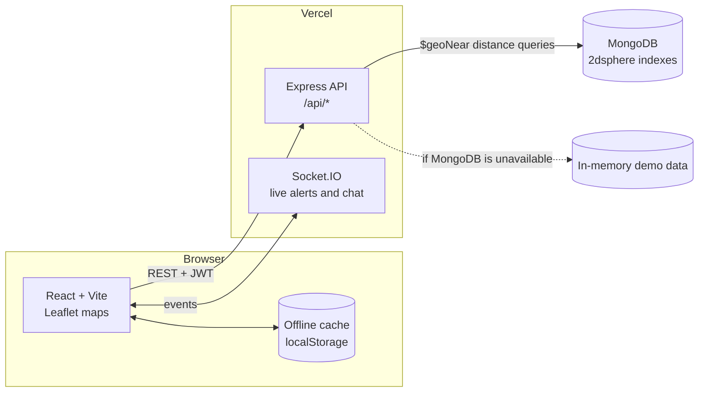

# LineVigil

[](https://github.com/asmikumari/linevigil-iocl-site/actions/workflows/ci.yml)

**Right-of-way protection for oil and gas pipelines.** Contractors request excavation permits on a map, every dig site is measured against the pipeline and given a risk level, admins dispatch patrol officers, and officers verify the site on the ground, even without network coverage.

Built during my Software Development Engineer internship at **Indian Oil Corporation Limited (IOCL)**, May to July 2026.

[**Live demo**](https://linevigil-iocl-site-t87k.vercel.app) · [Walkthrough of each portal](#the-three-portals) · [Design decisions](ARCHITECTURE.md) · [Run it locally](#run-it-locally)



## Why it exists

Accidental digging by third parties is one of the most common causes of damage to buried pipelines. Pipeline operators keep a protected corridor, the right-of-way, along each line, but excavation requests near it are often tracked on paper or in spreadsheets, and patrol teams in rural stretches regularly lose mobile signal.

LineVigil puts the whole process on one live map: who wants to dig, how close they are to the pipe, who is going to check, and what they found.

## How a dig gets cleared

| Step | Who | What happens |
| --- | --- | --- |
| 1. Request | Contractor | Marks the dig site on the right-of-way map and files an excavation permit. |
| 2. Measure | LineVigil | Calculates the geodesic distance from the site to the nearest pipeline centreline and sets the risk level. |
| 3. Dispatch | Admin | Reviews the permit and assigns a patrol officer. |
| 4. Verify | Patrol officer | Inspects the site in person. GPS tracks and reports are cached offline and sync when signal returns. |

**Risk levels by distance to the pipeline.** One rule, defined once on the server, is used for permits, the live site check, detections and patrol alerts.

| Distance | Risk |
| --- | --- |
| Under 500 m | High |
| 500 m to 1 km | Medium |
| Over 1 km | Low |

## The three portals

### Admin

The command view. Every pipeline route, excavation permit, patrol and alert sits on one map. Admins assign patrols, review permits and track detections near the pipelines. No imagery provider is connected, so the satellite sweep is a labelled simulation: it places a test detection near a real route and scores it with the same distance rule.





### Patrol officer

Built for the field. Officers see their assigned sites, navigate the corridor, run a site checklist and report incidents with photos. The app shell is cached by a service worker, so it opens with no signal and shows the tasks from the last sync. While offline it keeps recording the device's GPS track; one tap uploads everything once the officer is back in range, and retries never create duplicate points.



### Contractor

Contractors pick the dig site on the map, see the automatic proximity check straight away, and follow each permit from filing through patrol verification to approval.



## Architecture



- **Distance checks.** With MongoDB, the nearest pipeline is found with a `$geoNear` query on a `2dsphere` index. Without a database, the API uses an in-memory dataset and measures point-to-line distance with a local projection plus haversine, accurate to a few metres at pipeline scale.
- **Offline-first patrols.** A service worker caches the app shell. The patrol portal queues GPS points and reports in local storage while offline and replays them on reconnect. Each point carries a device-generated `client_id`, and a unique index makes the upload safe to retry.
- **Role-based access.** Logins return a JWT that every API request carries. Every route checks the role on the server (401 for a missing or expired session, 403 for the wrong role), sign-up can only create contractor accounts, and sign-in is rate-limited.

The reasoning behind each of these, and what they cost, is in [ARCHITECTURE.md](ARCHITECTURE.md).

## Tech stack

| Layer | Tools |
| --- | --- |
| Frontend | React 18, Vite, React Router, Tailwind CSS, Leaflet / React Leaflet, Socket.IO client, Framer Motion |
| Backend | Node.js 20+, Express 5, Socket.IO, JSON Web Tokens, bcrypt |
| Data | MongoDB with geospatial indexes, in-memory fallback dataset |
| Testing and CI | Node's built-in test runner (unit and API tests), GitHub Actions |
| Hosting | Vercel (frontend and API as two services in one project), Docker Compose for local runs |

## Run it locally

You need Node.js 20 or later. MongoDB is optional: without it the backend runs on the built-in demo data.

```bash
# 1. Backend (http://localhost:5001)
cd backend
npm install
echo "JWT_SECRET=any-long-random-string" > .env
# optional: echo "MONGODB_URI=mongodb://localhost:27017/linevigil" >> .env
# optional, with MongoDB: npm run seed
npm run dev
```

```bash
# 2. Frontend (http://localhost:5173)
cd frontend
npm install
npm run dev
```

Or run everything, including MongoDB, with Docker:

```bash
docker compose up --build
```

### Tests

```bash
cd backend
npm test
```

The tests start the real API on a random port with the in-memory dataset, so they need no database. CI runs them, plus a production build of the frontend, on every pull request.

### Demo accounts

The landing page has one-click demo buttons. To sign in by hand, all three use the password `password123`.

| Role | Email |
| --- | --- |
| Admin | `admin@linevigil.com` |
| Patrol officer | `patrol@linevigil.com` |
| Contractor | `contractor@linevigil.com` |

## Deploying to Vercel

The root [`vercel.json`](vercel.json) deploys the frontend and the API as two services in one Vercel project. `/api/*` and `/socket.io/*` go to the backend; every other path goes to the frontend, which serves `index.html` so React Router can handle page links and refreshes.

Set these environment variables in the Vercel project:

| Variable | Required | Purpose |
| --- | --- | --- |
| `JWT_SECRET` | Yes | Signs login tokens. In production there is no fallback: without it, sign-in fails. |
| `MONGODB_URI` | No | Connection string for MongoDB. Without it the API uses the demo dataset. |
| `CORS_ORIGIN` | No | Comma-separated list of allowed browser origins. Only needed when the frontend is on a different domain from the API. |
| `AUTH_RATE_LIMIT` | No | Sign-in and sign-up attempts allowed per IP per minute (default 10). |
| `LINEVIGIL_DB` | No | Set to `memory` to skip MongoDB and use the demo dataset. |
| `VITE_CARTO_API_KEY` | No | Free [CARTO Basemaps key](https://carto.com/basemaps/apikey) for the dark map tiles. Without it the map uses Esri's keyless dark basemap. Copy `frontend/.env.example` to `frontend/.env` for local runs. |

The headline font is [Oblisk](https://www.1001fonts.com/oblisk-font.html) by Maiko Hatta, used under its free-for-personal-use licence (see [`frontend/public/fonts/OBLISK-LICENSE.txt`](frontend/public/fonts/OBLISK-LICENSE.txt)). It is not licensed for commercial use.

Vercel's serverless functions do not hold long-lived connections, so Socket.IO live updates work best when the backend runs on a long-running host. Everything else works over REST. Check a deployment with `GET /api/health`.

## Project structure

```
backend/
  app.js              Express app: security headers, CORS, routes, JSON errors
  index.js            HTTP and Socket.IO server
  db.js               MongoDB access, geospatial queries, in-memory fallback
  lib/                Geodesy, risk rule, config, HTTP errors, rate limit, sample data
  middleware/auth.js  JWT verification and role checks
  routes/             auth, excavations, pipelines, patrol, imagery, cgd
  test/               Unit and API tests
frontend/
  src/pages/          Landing page and the admin, patrol and contractor portals
  src/components/     Map, sidebar, header and layout
  src/services/api.js API client
  public/sw.js        Service worker for the offline app shell
ARCHITECTURE.md       Design decisions and trade-offs
docs/
  api_documentation.md  REST and Socket.IO reference
  screenshots/          Images used in this README
```

The full API reference is in [`docs/api_documentation.md`](docs/api_documentation.md).

## Notes

LineVigil was built as an internship project. The demo uses sample pipeline routes, permits and detections. It is not connected to any live IOCL system, and detections from the satellite sweep are simulated and labelled as such in the API and the interface.

## Author

**Asmi Kumari**, B.Tech Computer Science and Engineering, Amity University Noida (2023 to 2027)

[LinkedIn](https://www.linkedin.com/in/asmikumari) · [GitHub](https://github.com/asmikumari)
