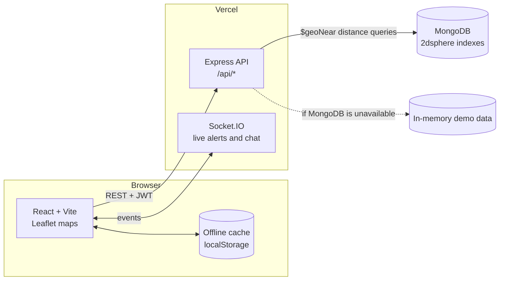

# LineVigil

**Right-of-way protection for oil and gas pipelines.** Contractors request excavation permits on a map, every dig site is measured against the pipeline and given a risk level, admins dispatch patrol officers, and officers verify the site on the ground, even without network coverage.

Built during my Software Development Engineer internship at **Indian Oil Corporation Limited (IOCL)**, May to July 2026.

[**Live demo**](https://linevigil-iocl-site-t87k.vercel.app) · [Walkthrough of each portal](#the-three-portals) · [Run it locally](#run-it-locally)


## Why it exists

Accidental digging by third parties is one of the most common causes of damage to buried pipelines. Pipeline operators keep a protected corridor, the right-of-way, along each line, but excavation requests near it are often tracked on paper or in spreadsheets, and patrol teams in rural stretches regularly lose mobile signal.

LineVigil puts the whole process on one live map: who wants to dig, how close they are to the pipe, who is going to check, and what they found.

## How a dig gets cleared

| Step | Who | What happens |
| --- | --- | --- |
| 1. Request | Contractor | Marks the dig site on the right-of-way map and files an excavation permit. |
| 2. Measure | LineVigil | Calculates the distance from the site to the nearest pipeline centreline and sets the risk level. |
| 3. Dispatch | Admin | Reviews the permit and assigns a patrol officer. |
| 4. Verify | Patrol officer | Inspects the site in person. GPS tracks and reports are cached offline and sync when signal returns. |

**Risk levels by distance to the pipeline**

| Distance | Risk |
| --- | --- |
| Under 500 m | High |
| 500 m to 1 km | Medium |
| Over 1 km | Low |

## The three portals

### Admin

The command view. Every pipeline route, excavation permit, patrol and alert sits on one map. Admins assign patrols, review permits and run satellite sweeps that flag excavation machinery inside the buffer zones.


### Patrol officer

Built for the field. Officers see their assigned sites, navigate the corridor, run a site checklist and report incidents with photos. When the network drops, the app switches to local caching and keeps recording the GPS track; one tap uploads everything once the officer is back in range.


### Contractor

Contractors pick the dig site on the map, see the automatic proximity check straight away, and follow each permit from filing through patrol verification to approval.


## Architecture



- **Distance checks.** With MongoDB, the nearest pipeline is found with a `$geoNear` query on a `2dsphere` index. Without a database, the API falls back to an in-memory dataset and computes point-to-line distance with the haversine formula, so the demo always works.
- **Offline-first patrols.** The patrol portal watches the connection, keeps writing GPS points and incident reports to local storage while offline, and replays them to the API on reconnect.
- **Role-based access.** Logins return a JWT that every API request carries. Each role gets its own portal, and admin-only actions such as assigning patrols check the role on the server.

## Tech stack

| Layer | Tools |
| --- | --- |
| Frontend | React 18, Vite, React Router, Tailwind CSS, Leaflet / React Leaflet, Socket.IO client, Framer Motion |
| Backend | Node.js, Express 5, Socket.IO, JSON Web Tokens, bcrypt |
| Data | MongoDB with geospatial indexes, in-memory fallback dataset |
| Hosting | Vercel (frontend and API as two services in one project), Docker Compose for local runs |

## Run it locally

You need Node.js 18 or later. MongoDB is optional: without it the backend runs on the built-in demo data.

```bash
# 1. Backend (http://localhost:5001)
cd backend
npm install
echo "JWT_SECRET=any-long-random-string" > .env
echo "PORT=5001" >> .env
# optional: echo "MONGODB_URI=mongodb://localhost:27017/linevigil" >> .env
npm run dev
```

```bash
# 2. Frontend (http://localhost:5173)
cd frontend
npm install
npm run dev
```

Or run everything, including MongoDB, with Docker:

```bash
docker compose up --build
```

### Demo accounts

The landing page has one-click demo buttons. To sign in by hand, all three use the password `password123`.

| Role | Email |
| --- | --- |
| Admin | `admin@linevigil.com` |
| Patrol officer | `patrol@linevigil.com` |
| Contractor | `contractor@linevigil.com` |

## Deploying to Vercel

The root [`vercel.json`](vercel.json) deploys the frontend and the API as two services in one Vercel project. `/api/*` and `/socket.io/*` go to the backend; every other path goes to the frontend, which serves `index.html` so React Router can handle page links and refreshes.

Set these environment variables in the Vercel project:

| Variable | Required | Purpose |
| --- | --- | --- |
| `JWT_SECRET` | Yes | Signs login tokens. |
| `MONGODB_URI` | No | Connection string for MongoDB. Without it the API uses the demo dataset. |
| `VITE_CARTO_API_KEY` | No | Free [CARTO Basemaps key](https://carto.com/basemaps/apikey) for the dark map tiles. Without it the map uses Esri's keyless dark basemap. Copy `frontend/.env.example` to `frontend/.env` for local runs. |

The headline font is [Oblisk](https://www.1001fonts.com/oblisk-font.html) by Maiko Hatta, used under its free-for-personal-use licence (see [`frontend/public/fonts/OBLISK-LICENSE.txt`](frontend/public/fonts/OBLISK-LICENSE.txt)). It is not licensed for commercial use.

Note that Vercel's serverless functions do not hold long-lived connections, so Socket.IO live updates work best when the backend runs on a long-running host.

## Project structure

```
backend/
  index.js            Express app, Socket.IO server, route mounting
  db.js               MongoDB access, geospatial queries, in-memory fallback
  middleware/auth.js  JWT verification
  routes/             auth, excavations, pipelines, patrol, imagery, cgd
frontend/
  src/pages/          Landing page and the admin, patrol and contractor portals
  src/components/     Map, sidebar, header and layout
  src/services/api.js API client
docs/
  api_documentation.md  REST and Socket.IO reference
  screenshots/          Images used in this README
```

The full API reference is in [`docs/api_documentation.md`](docs/api_documentation.md).

## Notes

LineVigil was built as an internship project. The demo uses sample pipeline routes, permits and detections; it is not connected to any live IOCL system, and the satellite sweep generates simulated detections.

## Author

**Asmi Kumari**, B.Tech Computer Science and Engineering, Amity University Noida (2023 to 2027)

[LinkedIn](https://www.linkedin.com/in/asmikumari) · [GitHub](https://github.com/asmikumari)
